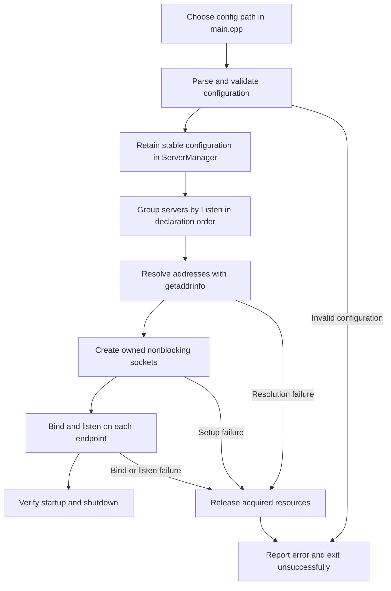

# WEB-Serv-42

An educational HTTP server built in C++. The project focuses on non-blocking network I/O, incremental HTTP parsing, configuration-driven routing, static responses, and CGI.

Project page: <https://muta-pro.github.io/WEB-Serv-42/>

## Current status

The Phase 0 shared-contract baseline and configuration parser are merged.
`ConfigParser::parseFile()` reads configuration files, validates them, and
returns fully resolved server and location settings.

The executable remains a scaffold: `main.cpp` does not yet load configuration
or open listeners. HTTP request parsing, routing, the network event loop, and
CGI execution remain implementation work.

The canonical design reference is [Base-Layer Architecture and Design Contracts](docs/BASE_LAYER_ARCHITECTURE.md).

## Request lifecycle

```text
configuration startup
        |
        v
accept client -> receive bytes -> parse HttpRequest
                                  |
                                  v
                         produce RouteResult
                                  |
                                  v
                         build HttpResponse
                                  |
                                  v
                         serialize and send
                                  |
                                  v
                          keep alive or close
```

TCP provides a stream of bytes, not complete HTTP messages. A request may arrive across several `recv()` calls, and one `recv()` may contain bytes from more than one request. Likewise, one `send()` may transmit only part of a response.

## Responsibility areas

| Area | Responsibility |
|---|---|
| Configuration | Parse, validate, apply defaults and inheritance, then freeze server and location settings before accepting clients. |
| Network/runtime | Own listeners and client sessions, run the readiness loop, perform non-blocking reads and writes, track timeouts, and remove closed clients. |
| HTTP parser | Incrementally turn client bytes into one owning `HttpRequest`, without touching sockets or choosing filesystem paths. |
| Router | Select the virtual server and location, validate the method and path, and return exactly one `RouteAction`. |
| Response builder | Execute the route decision: load files, create redirects and errors, generate autoindex output, or use CGI output. |
| Serializer | Convert `HttpResponse` into one correctly framed HTTP byte string. |
| CGI runtime | Own the child process and pipe descriptors, enforce timeouts, and return buffered CGI output without blocking the event loop. |

Current team areas:

- Paola (C): request parsing and routing;
- Ravi (B): configuration, response building, and CGI-output parsing;
- Ivan (A): network/runtime and CGI process execution.

## Core baseline decisions

- `Connection` owns exactly one accepted client FD. Destroying the connection closes it.
- The event loop may call `recv()`, `send()`, and the selected readiness API, but it does not separately close a `Connection`-owned FD.
- Each client session has its own `HttpRequestParser` because different clients can hold different partial requests.
- Completed `HttpRequest` and `HttpResponse` objects own their strings.
- `std::string_view` is used only for temporary non-owning inputs where the backing data remains valid for the call.
- `HttpRequest` contains protocol information only; routing and filesystem information belongs in `RouteResult`.
- Configuration is immutable after startup so route results may safely borrow `const` pointers to it.
- `RouteResult` contains one scoped `RouteAction`, not several potentially contradictory booleans.
- The response serializer derives the reason phrase, emits one authoritative `Content-Length` when allowed, and handles bodyless responses and `HEAD` correctly.
- The first implementation is single-threaded. One event-loop owner means no locking is required for client-session state.

## Shared contracts

The common baseline includes:

```text
ConnectionState
Connection
Client (per-client session)
CaseInsensitiveLess
HeaderMap
HttpRequest
HttpRequestParser
ParseResult
ConfigParser / ConfigError
ServerConfig / LocationConfig / Listen
RouteResult / RouteAction
HttpResponse
Router interface
ResponseBuilder interface
CGI runtime contract
```

Shared headers are contracts between branches. A branch may change private implementation details, but public contract changes require team agreement.

Configured methods use `std::set<HttpMethod>`, and `allowsMethod()` takes an
`HttpMethod`. GET implicitly grants HEAD. `ServerConfig::clientMaxBody` is the
largest effective location body limit in that server; routing must still apply
the selected location's exact limit.

## Event-readiness API

The exact readiness API must match the assigned subject and evaluation platform. `select()`, `poll()`, `epoll`, and `kqueue` have different portability and scaling properties; none should be selected solely from a simplified Big-O claim.

The first server should implement one approved API directly. A template abstraction for several backends is intentionally deferred until the project genuinely needs a second backend.

## Build policy

The project uses C++17 with `-Wall -Wextra -Werror`.

Run these commands from the repository root:

```sh
make
make test
make -C tests/ConfigParser
```

`make test` builds the scaffold, independently compiles every shared header,
and runs the contract smoke tests. The separate config-parser suite contains
469 tests with AddressSanitizer and UBSan enabled by default. Root `make test`
does not currently run that suite, so run both test commands.

Example configuration is in `conf/default.conf`; `conf/multi_server.conf`
covers shared listeners and virtual hosts. These files can be read through
`ConfigParser::parseFile()`, but the executable does not consume them yet.

## Team workflow

1. Start feature work from current `main`, or integrate it into an existing feature branch.
2. Use the shared types and interfaces; coordinate changes to public contracts.
3. Run the contract checks, config-parser suite, and checks relevant to the feature.
4. Open a pull request; do not bypass review by pushing directly to protected `main`.
5. Keep related branches synchronized after shared-contract changes merge.

## Next milestone

The next network/runtime milestone is configuration-driven listener startup:



Implementation order and acceptance checks:

1. **Entry point:** accept zero or one config argument, default to
   `conf/default.conf`, and reject extra arguments. Catch `ConfigError`, report
   its message, and exit unsuccessfully before opening listeners.
2. **Configuration ownership:** let `ServerManager` retain the final settings.
   Establish borrowed references only after storage is stable, and keep it
   unchanged while listeners and client sessions use it.
3. **Listener grouping:** associate each distinct `Listen` with an ordered list
   of candidate servers. Shared server blocks use one listener; a server with
   several listens participates in several groups. `conf/multi_server.conf`
   describes three listener groups, with two server candidates on port 8080.
4. **Address resolution:** resolve configured hosts with `getaddrinfo`, release
   its results, and report resolution errors. Detect or clearly report endpoint
   conflicts caused by aliases or overlapping addresses.
5. **Socket ownership:** use a move-only owner for listening FDs, separate from
   `Connection`, which owns accepted client FDs. Configure socket options and
   nonblocking mode while preserving existing flags. Release the FD on failure.
6. **Binding and lifecycle:** bind and listen on every required endpoint. If any
   step fails, release listeners already opened and report the failed endpoint.
   Test an occupied port and repeated startup/shutdown for resource leaks.

This milestone ends with tested listener startup and cleanup. Accepting clients
and processing requests belong to the following connection lifecycle:

```text
accept -> receive -> fake/incremental parse -> fake route
       -> build "hello" response -> partial send -> close
```

Full routing, keep-alive, configured error pages, CGI, and autoindex follow
after this path works. Production HTTP parsing remains the HTTP branch's responsibility.
